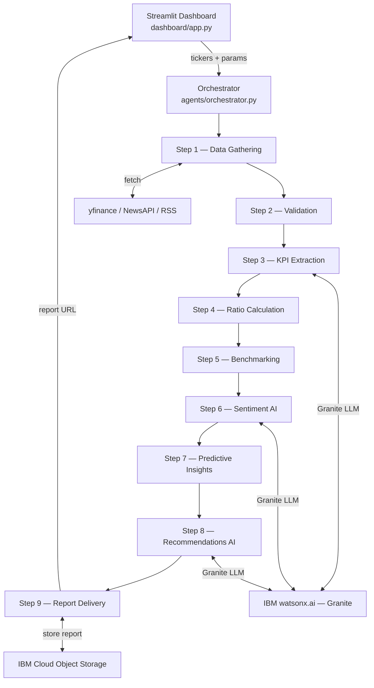

# Investment Analyst Agent

> An AI-powered sequential task agent that performs end-to-end investment analysis using **IBM Granite** (via watsonx.ai), **IBM Cloud Object Storage**, and a **Streamlit** dashboard.

---

## Architecture



---

## Project Structure

```
investment-analyst-agent/
├── app/
│   ├── config.py                    ← env vars + Settings dataclass
│   ├── models/state.py              ← Pydantic AnalysisState + schemas
│   ├── agents/
│   │   ├── orchestrator.py          ← sequential runner, retries, callbacks
│   │   ├── step1_data_gathering.py
│   │   ├── step2_validation.py
│   │   ├── step3_kpi_extraction.py
│   │   ├── step4_ratios.py
│   │   ├── step5_benchmarking.py
│   │   ├── step6_sentiment.py
│   │   ├── step7_predictive.py
│   │   ├── step8_recommendations.py
│   │   └── step9_report.py
│   ├── services/
│   │   ├── watsonx_client.py        ← IBM Granite wrapper + mock
│   │   ├── data_sources.py          ← yfinance + news + mock factories
│   │   └── storage.py               ← COS upload/download + local fallback
│   └── prompts/
│       ├── kpi_extraction.txt
│       ├── sentiment_classification.txt
│       └── recommendation.txt
├── dashboard/app.py                 ← Streamlit UI
├── tests/
│   ├── test_ratios.py
│   ├── test_validation.py
│   └── test_orchestrator.py
├── Dockerfile
├── requirements.txt
├── .env.example
├── demo.py
└── README.md
```

---

## Prerequisites

- Python 3.11+
- IBM Cloud account with:
  - watsonx.ai project (au-syd region)
  - Cloud Object Storage instance (optional — local fallback is available)
- (Optional) NewsAPI key for live news

---

## Local Setup

```bash
# 1. Clone / enter the project
cd investment-analyst-agent

# 2. Create virtual environment
python -m venv .venv
source .venv/bin/activate          # Windows: .venv\Scripts\activate

# 3. Install dependencies
pip install -r requirements.txt

# 4. Configure environment
cp .env.example .env
# Edit .env and fill in your WATSONX_API_KEY, WATSONX_PROJECT_ID, etc.

# 5. Run in mock mode (no credentials needed)
MOCK_MODE=true streamlit run dashboard/app.py

# 6. Run with real IBM Granite + COS
streamlit run dashboard/app.py
```

---

## Run the Demo Script

```bash
cd investment-analyst-agent
python demo.py
```

Analyses **TCS.NS + INFY.NS** vs **WIPRO.NS + HCLTECH.NS** in mock mode and prints recommendations to the terminal.

---

## Run Tests

```bash
cd investment-analyst-agent
pip install pytest pytest-mock
pytest tests/ -v
```

---

## Docker

```bash
# Build
docker build -t invest-analyst .

# Run locally (mock mode)
docker run -p 8501:8501 -e MOCK_MODE=true invest-analyst

# Run with real credentials
docker run -p 8501:8501 \
  -e WATSONX_API_KEY=<key> \
  -e WATSONX_PROJECT_ID=<id> \
  -e WATSONX_URL=https://au-syd.ml.cloud.ibm.com \
  -e GRANITE_MODEL_ID=ibm/granite-13b-instruct-v2 \
  invest-analyst
```

---

## Deploy to IBM Cloud Code Engine

### 1. Prerequisites — install IBM Cloud CLI + plugins

```bash
# IBM Cloud CLI
curl -fsSL https://clis.cloud.ibm.com/install/linux | sh

# Plugins
ibmcloud plugin install code-engine
ibmcloud plugin install container-registry

# Login
ibmcloud login --apikey <YOUR_IBM_CLOUD_API_KEY> -r au-syd
```

### 2. Provision watsonx.ai

```bash
# Via IBM Cloud catalog — create a Watson Machine Learning instance in au-syd
ibmcloud resource service-instance-create invest-wml pm-20 lite au-syd

# Note your watsonx.ai project ID from https://au-syd.dataplatform.cloud.ibm.com
```

### 3. Provision Cloud Object Storage

```bash
ibmcloud resource service-instance-create invest-cos \
    cloud-object-storage lite global

# Create a bucket
ibmcloud cos bucket-create \
    --bucket investment-analyst-reports \
    --ibm-service-instance-id $(ibmcloud resource service-instance invest-cos --id | tail -1) \
    --region au-syd
```

### 4. Push image to IBM Container Registry

```bash
ibmcloud cr login
ibmcloud cr namespace-add invest-analyst-ns
docker tag invest-analyst au.icr.io/invest-analyst-ns/invest-analyst:latest
docker push au.icr.io/invest-analyst-ns/invest-analyst:latest
```

### 5. Create Code Engine application

```bash
ibmcloud ce project create --name invest-analyst-proj
ibmcloud ce project select  --name invest-analyst-proj

ibmcloud ce app create \
  --name invest-analyst \
  --image au.icr.io/invest-analyst-ns/invest-analyst:latest \
  --port 8501 \
  --min-scale 0 \
  --max-scale 2 \
  --memory 2G \
  --cpu 1 \
  --env WATSONX_API_KEY=<key> \
  --env WATSONX_PROJECT_ID=<project_id> \
  --env WATSONX_URL=https://au-syd.ml.cloud.ibm.com \
  --env GRANITE_MODEL_ID=ibm/granite-13b-instruct-v2 \
  --env COS_API_KEY=<cos_key> \
  --env COS_INSTANCE_CRN=<cos_crn> \
  --env COS_BUCKET=investment-analyst-reports \
  --env COS_ENDPOINT=https://s3.au-syd.cloud-object-storage.appdomain.cloud \
  --env MOCK_MODE=false

# Get the public URL
ibmcloud ce app get --name invest-analyst --output url
```

---

## Environment Variables

| Variable | Required | Default | Description |
|---|---|---|---|
| `WATSONX_API_KEY` | Yes (real mode) | — | IBM Cloud API key |
| `WATSONX_URL` | No | `https://au-syd.ml.cloud.ibm.com` | watsonx.ai endpoint |
| `WATSONX_PROJECT_ID` | Yes (real mode) | — | watsonx.ai project ID |
| `GRANITE_MODEL_ID` | No | `ibm/granite-13b-instruct-v2` | Granite model to use |
| `COS_API_KEY` | No | — | COS API key (local fallback if absent) |
| `COS_INSTANCE_CRN` | No | — | COS instance CRN |
| `COS_BUCKET` | No | `investment-analyst-reports` | COS bucket name |
| `COS_ENDPOINT` | No | au-syd COS endpoint | COS S3 endpoint |
| `NEWS_API_KEY` | No | — | NewsAPI key (RSS fallback if absent) |
| `MOCK_MODE` | No | `false` | `true` = fully offline with synthetic data |

---

## Pipeline Steps

| # | Step | AI? | Description |
|---|---|---|---|
| 1 | Data Gathering | — | yfinance prices, fundamentals, news, analyst opinions |
| 2 | Validation | — | Null checks, staleness, outliers, currency mismatch, dedup |
| 3 | KPI Extraction | ✅ Granite | Revenue, margins, EPS, debt; Granite fills gaps |
| 4 | Ratio Calculation | — | P/E, P/B, ROE, beta, volatility, max drawdown |
| 5 | Benchmarking | — | Ranked peer comparison + relative-strength z-scores |
| 6 | Sentiment Analysis | ✅ Granite | Per-news sentiment + daily index |
| 7 | Predictive Insights | — | MA crossover, linear forecast, 5 risk indicators |
| 8 | Recommendations | ✅ Granite | Buy/Hold/Reduce with reasoning + citations |
| 9 | Report Delivery | — | JSON + HTML report → COS or local |

---

## Disclaimer

> ⚠️ All analysis and recommendations are AI-generated for **educational purposes only** and do **not** constitute financial advice. Always consult a qualified financial advisor before making investment decisions.

---

*Made with [IBM Bob](https://www.ibm.com/products/bob)*
